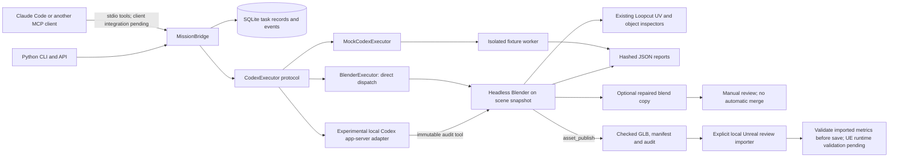

# CryptoNyan Asset Studio — architecture and gaps

Audit date: 2026-10-21. Reference: `swisspatate/loopcut` main commit
`e07488212ab7f87c77c8b5792785e57620d61ea0` (Loopcut v0.2.5 beta).

## Audit provenance

The supplied workspace contained no checkout. Git HTTPS could not reach its configured
proxy; the additional-network attempt was cancelled. Sources were retrieved through
the GitHub connector at the pinned commit. The local Git repository is an **offline
partial snapshot**, not a clone with upstream history. It includes the add-on Python
sources, selected regression tests/fixtures and the documents inspected below. No root
or applicable directory `AGENTS.md` was found at the audited paths. The feature branch
is `feat/cryptonyan-mission-bridge-asset-doctor`.

Follow-up (v0.2): an independent `CodexAppServerExecutor` now implements local
app-server dispatch to the same worker contract. It does not alter the audited
native Loopcut control flow. See [codex-adapter.md](codex-adapter.md) for exact
authentication, permission, protocol and validation boundaries.

Follow-up (v0.11): the [creative toolkit](creative-toolkit.md) reuses process isolation,
safe storage, PBR construction/validation, preview budgets, Loopcut's GLB structural
checks and action-curve compatibility helper. Its animated quadruped uses Blender's
glTF operator with explicit action sampling, separately from the static publisher
contract. The Unreal runtime adds elemental components and UMG; native Loopcut agent
dispatch remains unchanged.

Follow-up (v0.12): `GameProject` adds opt-in, read-only discovery of an existing
Unreal checkout and binds TextureService requests to one source-file SHA-256 and
an intended surface. It reuses the profile catalog, HTTP adapter, PNG material
validation, workspace lock and path boundaries. Native project 3D profiles remain
metadata, not executable texture profiles. No game scripts, editor calls, rig
inspection, dependency traversal or asset replacement are introduced. See
[existing-project.md](existing-project.md). Generated creative assets are optional
fixtures; improvements should reuse the game's own assets and runtime systems.

Follow-up (v0.13): `unreal_material_variants.py` reads actual editor asset classes,
mesh slots, material parent/parameter values, skeleton references and direct registry
dependencies. A plan links that deterministic inspection to the owned texture candidate.
The editor revalidates sources, imports explicit PNG channels, creates a child MIC and
duplicates the mesh for one-slot preview. Only new assets are saved; source meshes and
levels are never assigned or saved. `project_material_plan` exposes the offline step
through the existing MCP service. Editor API doubles test the protocol, not UE compatibility.

Follow-up (v0.14): `comfy_preflight.py` reuses LocalHTTP and the approved profile
catalog for one bounded GET of ComfyUI node metadata. The optional `texture_preflight`
MCP tool compares the effective prompt/seed graph, choices, input bounds and links.
This advisory diagnostic creates no jobs or files and never changes submission
idempotency. Custom validation, model bytes, VRAM and GPU execution remain unchecked.

After the GitHub integration permissions were updated, remote branch creation
succeeded. Publication uses the real upstream commit and tree as its parent/base,
adding only the feature files listed in [changed-files.md](changed-files.md).
The offline snapshot commits are excluded from the remote branch history.

## Verified existing behavior

| Source | Observed responsibility / implication |
| --- | --- |
| `agent.py:_configure` (lines 454–485 at reference) | Checks `config.codex_app()` first and returns with `CODEX_SPEC`; only afterwards considers `ORCH_SPEC`. The two modes do not nest. |
| `agent.py:CODEX_SPEC`, `codex_app.py` | `CODEX_SPEC` replaces `WORKSPACE_SPEC.drive`. A local `codex app-server` handles a persistent Codex thread over stdio JSON-RPC. This is an existing experimental local CLI integration, not a Codex Cloud endpoint. |
| `codex_app.py:command/environment` | Explicitly disables configured MCP servers for this app-server invocation. Preserves the user's Codex sign-in and removes OpenAI/Codex API key variables. Adding an MCP server to the user's Codex config alone will not connect it here. |
| `config.py:load_roles`, `agent.py:_configure` | Native orchestration also depends on provider/role configuration and the hosted prompt index being available. Flags alone are insufficient. |
| `orchestrator.py` | Validates quoted requirements, ownership, scene layout, worker roles and acceptance checks. Existing roles include modeling, materials, lighting, camera and animation. |
| `workers.py:SPEC`, `waves.py` | Each native worker is an agent loop in a parent thread; its tools execute in an isolated Blender child. Waves manage shared budgets, snapshots, retries, reports and merging. This is different from launching nested Codex agents. |
| `worker_host.py`, `worker_ipc.py`, `ownership.py`, `merge.py` | Existing child IPC and ownership/merge machinery assumes live Loopcut state, main-thread calls and checkpoint semantics. It should be reused for future live integration rather than bypassed. |
| `workspace.py` | Conversation workspace, source snapshots, subprocess execution, cancellation, and explicit `apply_build` ownership/merge. Imports live Loopcut state; not a standalone service library. |
| `tools.py`, `object_info.py` | Live scene/tool dispatch and object inspection. Asset Doctor reuses `object_info.brief` without registering the UI. |
| `uv_tools.py` | Pure UV audit mathematics plus Blender operations. Asset Doctor calls `audit` on world-space vertices for small meshes; it does not invent another unwrap/UV inspector. |
| `texture_tools.py` | Detailed texture binding, sampling and paint diagnostics already exist. MVP only lists material slots and UV layers; detailed PBR analysis is deferred to this tool. |
| `glb.py` | Existing parsing, validation, summary and guarded GLB export. Reuse for future Unreal handoff; no second exporter added. |
| `inspection.py`, `VISUAL_INSPECTION.md` | Snapshot-based captures, camera/frame settings, hashes and freshness checks. Future visual QA should wrap this pipeline. |
| `jobs.py`, `RENDER_JOBS.md` | Durable render/export jobs with detached supervisor, deadlines, cancellation, asset hashes and output ownership. The new mission service is not a replacement for this subsystem. |

`loopcut/DEVELOPING.md`, README, LICENSE/COPYING, `pyproject.toml`, and the existing
test/release workflow files were inspected. Upstream is Blender 5.2.2 plus the Python
add-on and a small C++ integration surface. CI runs `unittest discover` on Python 3.13.
Release builds are manually triggered for Windows x64/macOS ARM64, involve native
libraries/GPU kernels and signing configuration. No C++ build or release workflow was run.
The extension adds no pip dependencies: Python 3.11+ standard library outside Blender;
`bpy` and the neighboring upstream modules inside the Blender child.

## Implemented extension boundary

New sibling package: `scripts/addons_core/cryptonyan_asset_studio/`. It never registers
UI or modifies upstream loops. This avoids importing `bpy` into the bridge and keeps
rebases local to an independent package. A narrow subprocess supervisor is necessary
because upstream `workspace`/`jobs` depend on the live add-on runtime. The existing UV
and object inspection functions are called directly from headless Blender.

The mock does not call Codex. The direct Blender executor is a real worker dispatcher
without an LLM. The new Codex adapter can invoke the local app-server, but a real
authenticated model turn has not been validated in this cloud. The MCP implementation
is a minimal stdio server implementing
initialize, ping, tools/list, tools/call and notification handling for protocol
`2024-11-05`; an actual Claude Code client handshake remains a local validation.
An independent subprocess client has exercised all five MCP tools over real stdio.

## Task and ownership semantics

Version 0.3 adds `asset_publish` for one explicit static mesh from one `.blend`.
It reuses the same mission/executor path and upstream GLB checks. It does not expand
the worker's ownership beyond its job directory. Unreal import is a separate local
editor action, with a fixed new review destination and an exclusive receipt file.
See [publisher.md](publisher.md) for supported assets and remaining engine validation.

- Immutable typed mission: task type, input paths, named target objects, constraints,
  success criteria. Task records add UUID, revision linkage, states, timestamps,
  executor identity, snapshot hashes and artifacts with size/hash/path.
- `queued → running → succeeded/failed`; `queued → cancelled`;
  `running → cancelling → cancelled`. Terminal records never restart in place.
  Revision submits a new immutable task after the old one is terminal.
- A successful audit may find an unacceptable asset: `state=succeeded` means execution
  completed; `quality_passed=false` means the acceptance criteria failed. CLI exits 1.
- A private workspace has one owning process protected by an OS advisory lock and
  SQLite transactions. Worker count is 1–8, pending tasks 1–1024 (default 128).
- Input copies are made at submission (maximum 32 inputs / 512 MiB). Original/snapshot
  hashes must agree. Each attempt has its own output directory. Total execution time,
  including retries/backoff, is bounded; preparation/queue wait is outside that budget.
- Up to three attempts; only `RetryableFailure` triggers retry. Timeout, validation and
  cancellation do not. The two built-in executors are subprocesses with hard termination.
  Future custom in-process executors must cooperate with the deadline/cancellation contract.
- Cancellation wins a race against result publication. Shutdown cancels outstanding
  work and waits for children to stop. On restart, interrupted running tasks fail and
  cancelling tasks become cancelled; queued tasks resume with the same executor type.
- Each worker owns only its output directory. No arbitrary scripts/shell commands are
  accepted through missions. No live scene merge, source save, Unreal write or automatic
  asset import exists. Scene copies needing repair are returned for manual review.
- Absolute paths, Windows drive/UNC forms, `..`, backslashes and symlink components are
  rejected. Workspaces must be private, outside the input root. This is protection
  against accidental overwrite/path traversal, **not an OS sandbox for hostile plugins**.
  A malicious local actor racing filesystem changes is outside this MVP's trust model.
- Events contain only ID, event, attempt and timestamp, not prompts, credentials or
  raw subprocess logs. Child environments are allowlisted. Worker errors are sanitized;
  provider authentication belongs in the Codex adapter, never in mission JSON.

## Asset Doctor boundaries

Dry run is the default. Reports distinguish measurements, warnings/errors, evidence and
repair suggestions. They contain base mesh counts, Blender tessellated triangle counts,
local/world bounds, scale/Euler rotation, slots, UV layers, invalid/degenerate/duplicate
face candidates and edge incidence/winding. No vertex-manifold proof, self-intersection
test, evaluated modifiers or aesthetic score is claimed. Degeneracy uses a documented
absolute area threshold; tiny legitimate faces require human judgment.

Mesh budgets: 200,000 vertices, 100,000 polygons, 500,000 corners, 128 objects/file.
Upstream detailed UV audit is capped at 3,000 corners and reports a skip above that.
Fixtures report local geometry only. No texture image sampling/GPU work is performed.

Opt-in repairs copy and rename simple meshes into a new collection and save to a new
job artifact. They never apply transforms or delete geometry. Objects with modifiers,
shape keys, parenting, constraints, animation, linked/override data, vertex groups or
children are guarded. The original objects remain in the returned scene alongside
copies; this is a review artifact, not an export-ready replacement scene.

External linked libraries/textures/caches are not bundled or rewritten. Relative
dependencies can become unresolved when a blend is copied. Use self-contained/packed
input scenes; dependency closure validation is a follow-up. Unexpected process death
may leave a child finishing its private attempt; restart never adopts it or signals
stored PIDs. An OS job-object/durable supervisor is needed before claiming crash-proof
worker reclamation on every platform.

## Planned vs tested

Version 0.3 implements constant-material GLB publication and a local Unreal import
script tested against a fake engine API. Version 0.4 adds a loopback ComfyUI HTTP
client, PNG/PBR bundles, new Blender material copies and embedded-texture publication.
It also reuses `texture_tools._Pixels` to reject coloured scalar maps that would create
Blender luminance/glTF red-channel ambiguity. See [material-pipeline.md](material-pipeline.md).
ComfyUI model provenance remains declared rather than server-attested. Live GPU execution
and Unreal runtime behavior remain unverified; textured automatic apply is explicitly
blocked pending material/texture gates. Version 0.5 implements a separate deterministic
flat runner planner, analytical movement checks, seed scanning and isolated Blender kit
worker; it reuses the existing audit/publication/process helpers. A neutral CSV prepares
the Unreal/PCG handoff; native PCGEx graph generation, quadruped animation and visual QA
remain contracts only. No actual gameplay, GPU performance or artistic quality is asserted.

The v0.8 world preview consumes the existing v0.7 world plan without changing its
schema or identity. `world_geometry.py` performs bounded cuboid/socket checks;
`world_preview.py` snapshots source modules and supervises the existing isolated
Blender process runner. `world_worker.py` appends only module mesh data and creates
zone collections and material overrides. Motion reuses `runner_motion.animate_preview`
and Loopcut's legacy/slotted F-curve helper, now with an optional common duration.
The default runner-kit duration stays two cycles. Success catalogs hash the output;
an optional source-root check revalidates provenance against current kits. Nothing
registers a Blender UI, invokes a model, submits ComfyUI work or changes an Unreal map.

Version 0.9 adds `world_materials.py`: complete biome/module assignments resolve through
Material Doctor and become an independently hashed appearance plan. World preview v2
catalogs include checked portable texture snapshots, while v1 catalogs remain supported.
The worker shares a packed material per input manifest and overrides it per object without
copying meshes. `create_packed_material` is extracted from the existing material-copy path
and reused by both callers; `validate_material` still enforces the original PBR envelope.

See [validation.md](validation.md) for exact executed commands/results and local checks,
and [roadmap.md](roadmap.md) for the next integration milestones.

## License and distribution

New code carries `GPL-3.0-or-later`, consistent with the root license and add-on policy.
Upstream attributions and third-party licenses remain untouched. No models, meshes,
logos or third-party packages were downloaded for this feature. Synthetic fixtures are
provided as source. "CryptoNyan Asset Studio" is the extension's name; this does not
grant rights to Loopcut or Blender branding. A distributed application fork still needs
its own product name/icons and corresponding GPL source/license notices. This PR does
not produce or rebrand a distributable native application.
