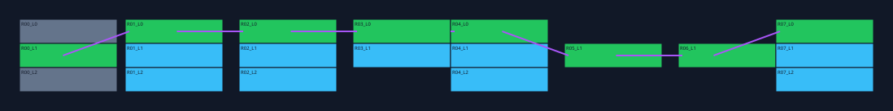

# Runner module kit — v0.5

Generate a reproducible three-lane platform layout, inspect analytical jump windows,
build a real Blender module/preview scene, and export an audited GLB plus a point table
for Unreal/PCG. This is a flat static-platform prototype, not a complete runner or a
native PCGEx plugin. It installs no third-party repository, model or dependency.



The SVG is a top-down review of the example recipe. Green platforms and purple lines
show one route accepted by the mathematical model; blue platforms are reachable,
orange platforms are reachable dead ends, and grey platforms are unreachable from
the specified centre-lane start. Lines do not simulate animation or collision.

## Commands

Use Python 3.11+ from the complete source checkout. Planning/scanning requires no Blender:

```powershell
$env:PYTHONPATH = (Resolve-Path .\scripts\addons_core).Path
$env:LOOPCUT_BLENDER = 'C:\Tools\Loopcut\blender.exe'
$work = Join-Path $env:LOCALAPPDATA 'CryptoNyanRunner'
New-Item -ItemType Directory -Force $work | Out-Null
Copy-Item .\docs\cryptonyan\examples\runner-recipe.json "$work\recipe.json"

py -3.13 -m cryptonyan_asset_studio.runner_kit plan "$work\recipe.json" `
  --destination "$work\plan-42"
Start-Process "$work\plan-42\preview.svg"

py -3.13 -m cryptonyan_asset_studio.runner_kit scan "$work\recipe.json" `
  --first-seed 0 --count 128 --report "$work\seed-scan.json"

py -3.13 -m cryptonyan_asset_studio.runner_kit build "$work\recipe.json" `
  --blender $env:LOOPCUT_BLENDER --timeout 120 --destination "$work\kit-42"
py -3.13 -m cryptonyan_asset_studio.runner_kit check "$work\kit-42"
```

Every output directory/report must be new. The CLI never overwrites or resumes an
existing kit. `plan` writes diagnostics even when the route fails; `build` also writes
those diagnostics but does not launch Blender after a failed movement preflight.
Exit code 0 means the requested operation passed its checks, 1 means a model/seed-scan
failure, and 2 means invalid input or an execution failure. A successful plan does not
mean assets were built: the result exposes `built` separately.

The default example uses seed 42, eight rows, 12 × 3 × 0.5 m platform blocks and gaps
chosen from 0, 1 and 2 m. Edit the [recipe](examples/runner-recipe.json), then generate
a new destination. The central lane is always present; side lanes are chosen by the
configured probability. The model can still reject the central path if gaps or movement
settings are unsuitable. Centre-only density is 0; all three lanes present is 1.

Bounds: 2–32 rows, 1–16 distinct gap choices in [0, 20] m, at most 96 placements;
platform length 4–50 m, width 1–10 m, thickness 0.1–3 m. Values must be finite, flags
cannot masquerade as numbers, and unknown fields are rejected. Scan examines 1–256
consecutive seeds in the unsigned 32-bit range and records each failing seed for replay.

## Files and reuse

| Output | Purpose |
| --- | --- |
| `layout.json` | Normalized recipe, stable layout ID, module dimensions/pivot/connectors and placements |
| `analysis.json` | Reachable arrivals, accepted/rejected transitions, launch windows, one route, dead ends and failing seed |
| `preview.svg` | Portable top-down inspection without Blender |
| `pcg-points.csv` | Explicit placement/exit coordinates converted to Unreal centimetres |
| `modules.blend` | One independent `RunnerPlatform` mesh, one UV map and a constant Principled material |
| `preview.blend` | Generated scene with linked mesh data positioned according to the layout |
| `publication/` | Existing Publisher contract: audited GLB, `quality.json` and `manifest.json` |
| `kit.json` | Layout/module identity and hashes/sizes of all nine data files |

`plan` produces only the first four files. `build` creates everything. `check` requires
a complete kit, recomputes the layout/analysis/CSV/SVG, verifies the artifact hashes and
validates the publication's geometry, dimensions, pivot and source-scene binding.

The worker starts with `--factory-startup --disable-autoexec` in an isolated subprocess,
uses the existing deadline/process-tree termination helper and a private runtime folder,
and never opens a user scene. It reuses Asset Doctor, Asset Publisher, the package loader
and Loopcut's glTF exporter. `modules.blend` is saved once, then checked unchanged after
publication and preview creation. A timeout/interruption may leave a partial output
directory; inspect it and choose a fresh destination. No rollback deletes user assets.

Module geometry has its origin at the **entry surface centre**: X runs from 0 to length,
Y from −width/2 to +width/2, and Z from −thickness to 0. Rotation and scale are identity.
Entry/exit positions and outward normals are written in the catalog and Blender custom
properties. These are connector metadata, not Blender empties or automatically created
Unreal sockets. UVs tile each face across 0–1; they are suitable for tiling textures,
not a unique lightmap/baking atlas. The [PBR pipeline](material-pipeline.md) can produce
a new textured copy of `modules.blend`, targeting object `RunnerPlatform`.

Layout generation uses indexed SHA-256 draws, not global random state. The same recipe
produces identical JSON/CSV/SVG across tested Python versions. Blender files, audit
timestamps and exporter bytes are not promised to be identical between builds or
Blender versions. Their actual hashes are recorded for each build.

This is a separate CLI/API build path; it does not add a new MCP mission type or change
Loopcut's native agent loop. The existing `asset_publish` mission can publish a generated
or subsequently edited module. Moving objects, ramps, ceilings, upper/lower branches,
portals, arbitrary module sets, native socket snapping and gameplay collision generation
are not implemented in this version.

## What the movement check means

The model assumes constant positive forward speed, an instantaneous vertical jump
velocity and constant gravity. All platform tops are at the same elevation. Therefore:

```text
flight time = 2 × jump speed / gravity
horizontal jump distance = forward speed × flight time
peak height = jump speed² / (2 × gravity)
```

The safe centre interval of each platform excludes `capsule_radius_m + landing_margin_m`
at each end. The validator intersects the source launch interval with the destination
landing interval shifted back by jump distance. The remaining interval must last at
least `min_launch_window_seconds`. It also leaves `recovery_seconds × forward speed`
after the previous landing before the next launch. Platform width must accommodate
the same lateral radius/margin. Adjacent-lane air control is allowed only when its
configured time fits within the flight; transitions directly across two lanes are rejected.

Propagation retains the earliest reachable landing position per platform. On the assumed
obstacle-free platform, later safe positions can be reached by running forward. This
prevents a false positive where each jump works in isolation but the first landing is
too late for the next jump's launch window. Tests include that exact counterexample.
Contiguous platforms in the same lane permit running without a jump. The first row's
side platforms are not considered initial spawn locations; within-row lane switching is
not modeled, so some feasible gameplay paths may be conservatively omitted.

`model_passed` means **at least one** route from the centre start reaches the final row
under these assumptions. It does not mean every offered branch is safe. Review the
`dead_ends`, `unreachable`, `rejected_edges` and `first_blocked_row` fields. There are no
obstacles, ceilings, slopes, acceleration, moving-platform phases, variable jump heights,
frame quantization, floor-contact handling or actual input/controller simulation here.
Every report explicitly sets `engine_validated=false`.

## Unreal / PCG / PCGEx handoff

`pcg-points.csv` is a **neutral table**, not an importable native PCGEx asset. Its columns
are `id,module,row,lane,x_cm,y_cm,z_cm,yaw_deg,scale_x,scale_y,scale_z,exit_x_cm,exit_y_cm,exit_z_cm`.
Conversion is `(Blender X, −Blender Y, Blender Z) × 100`; yaw is 0 and scale is 1.
The lane index retains its logical Blender meaning, so do not negate its coordinate twice.

In a scratch UE 5.8 project, first use the existing [Publisher import plan](publisher.md)
for `publication/manifest.json` and validate/import the constant-material module into a
new review folder. Then map the CSV fields through an explicit Unreal DataTable/point
loader into PCG/PCGEx position attributes, resolving `RunnerPlatform` to the imported
StaticMesh. Field mapping, plugin/version setup, graph construction and asset assignment
remain local manual steps. No CSV importer, Unreal placement automation or PCGEx binary
is silently installed. The catalog specifies one source LOD and no generated collision;
add and verify gameplay collision before attempting a playtest.

Required local acceptance:

1. Windows with the installed Loopcut binary: run `test_cryptonyan_runner.py`, build the
   example kit, open both scenes and compare dimensions, pivots, UVs and placements.
2. Unreal 5.8: verify the module import's units/axis/pivot, create collision in a review
   asset, map a small CSV sample, and compare first/last entry and exit positions.
3. The actual CryptoNyanRun character/controller: measure speed, jump velocity, effective
   gravity, capsule radius, lateral transition time and recovery; update the recipe and
   test both successful and rejected seeds. Observe landings at the edge of each window.
4. PCGEx: pin and validate a compatible stable UE 5.8 plugin version before replacing
   the manual point mapping with a version-specific adapter. Branches/moving platforms
   need dedicated runtime tests before being added to the supported envelope.

No Unreal editor, native PCGEx graph or real character-controller playtest has run in
cloud. Linux Blender tests establish asset generation/export/reimport, not those runtime
properties. The generated demo and seed scans are synthetic development assets.
