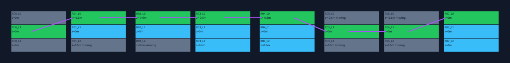

# Layered paths, cyclic lifts and material themes — v0.6

The existing runner builder now accepts a version 2 recipe for upper/lower side
branches and deterministic vertical moving platforms. A separate theme-batch command
applies explicit PBR bundles to several assets and exports every successful variant.
These features reuse the existing layout generator, isolated Blender launcher, Material
Doctor, Asset Doctor, Publisher and native Loopcut glTF helpers. They add no downloads,
model calls, native gameplay component or changes to Loopcut's agent loop.



## Build a layered runner

From the complete checkout, use Python 3.11+ and the actual Blender/Loopcut executable:

```powershell
$env:PYTHONPATH = (Resolve-Path .\scripts\addons_core).Path
$env:LOOPCUT_BLENDER = 'C:\Tools\Loopcut\blender.exe'
$work = Join-Path $env:LOCALAPPDATA 'CryptoNyanWorlds'
New-Item -ItemType Directory -Force $work | Out-Null

py -3.13 -m cryptonyan_asset_studio.runner_kit build `
  .\docs\cryptonyan\examples\layered-runner-recipe.json `
  --destination "$work\layered-42" --blender $env:LOOPCUT_BLENDER
py -3.13 -m cryptonyan_asset_studio.runner_kit check "$work\layered-42"
Start-Process "$work\layered-42\preview.blend"
```

The `plan` and `scan` commands from [runner-kit.md](runner-kit.md) also accept this
recipe. All destinations must be new. Version 1 recipes and their deterministic layout
IDs remain compatible. Version 2 adds these bounded parameters:

| Parameter | Meaning | Default / bounds |
| --- | --- | --- |
| `side_heights_m` | Rest elevations for lanes -1 and +1 | `[-0.6, 0.6]`, each -5 to +5 m |
| `motion.probability` | Moving-platform probability for interior side placements | 0.35 / 0–1 |
| `motion.amplitude_m` | Vertical displacement on either side of rest elevation | 0.5 / 0.05–3 m |
| `motion.period_frames` | One cycle at exactly 30 fps | 120 / 24–600, divisible by 4 |

Entry/exit rows and the centre lane stay at ground level and remain static. Side
branches occupy different lanes at different heights; this does not generate arbitrary
stacked rooms, ramps or tunnels. Interior side placements receive seed-derived phases.
Changing motion settings does not change the original placement draw sequence.

The static solver now uses the descending ballistic intersection with the target's
height: `t = (v + sqrt(v² - 2*g*dz)) / g`. It rejects targets at/above the jump apex,
preserves the landing/recovery propagation, and limits the launch interval so the
capsule clears an elevated platform's leading face before overlapping it in X.
Same-lane running requires equal elevations. These are analytical bounds, not full
swept-volume collision checks or an actual character-controller simulation.

**Moving platforms are excluded from the static solver.** `model_passed` still means
there is at least one static route to the final row. It never certifies a moving branch.
`dynamic_platforms` identifies those placements; `dynamics_validated=false` and
`engine_validated=false` remain explicit. Grey moving platforms in the SVG mean
unverified by this solver, not a demonstrated impossible jump. Heights and motion
labels are included in the top-down preview. Other unreachable/dead-end branches must
also be reviewed before treating the level as playable.

### Animation and Unreal handoff

`preview.blend` contains two cycles of actual location animation with linear keys,
shared mesh data and no script drivers. Frame 1 is time zero; playback range is
`1 .. 2*period_frames+1`. The final frame duplicates the first pose. Blender repeats
the preview through timeline playback; F-curves are baked only for that range, not
configured for indefinite extrapolation. The static published module stays unanimated.

Version 2 adds `motion-tracks.json`, included in the kit hashes and checked against
the canonical recipe. Each track contains placement ID, rest origin in Unreal
centimetres, amplitude in centimetres, period and phase in seconds. Rest coordinates
in `pcg-points.csv` deliberately differ from a moving object's frame-1 pose.

For a Blueprint/C++ consumer, use level elapsed time, not accumulated per-frame motion:

```text
q = fractional_part((elapsed_seconds + phase_seconds) / period_seconds)
wave = 1 - 4*abs(q - 0.25) when q < 0.75, otherwise 4*q - 4
location = origin_unreal_cm + (0, 0, amplitude_cm * wave)
```

The portable `runner_motion.position_at(placement, seconds)` implements the same
contract in Blender metres. It handles negative time and subframes. This enables
reproducible motion without drift. It does not model rider velocity inheritance,
collision, wait windows, networking, server-clock synchronization or jump timing.
The JSON/CSV are explicit adapter contracts; no Unreal actor is created automatically.

## Apply material themes by batch

Prepare saved self-contained `.blend` assets and checked `material.json` bundles using
the existing [PBR pipeline](material-pipeline.md). Bundles may come from approved local
ComfyUI jobs or another texture authoring tool, after explicit channel assignment.
Every asset needs a named local static mesh with one UV map. Existing static-publisher
guards and its one-material envelope still apply. The selected object's material slots
are replaced in a new scene copy; other objects retain their original materials.

Copy and edit [theme-recipe.json](examples/theme-recipe.json). Every theme explicitly
maps every asset ID to a material manifest, relative to one input root. Several assets
can share a bundle, or receive asset-specific bundles in the same theme. A theme name
such as `ice` is a label: this command does not generate textures from that word.

```powershell
$inputs = 'D:\CryptoNyan\ThemeInputs'
py -3.13 -m cryptonyan_asset_studio.theme_batch plan .\theme-recipe.json `
  --source $inputs --destination "$work\theme-plan.json"
py -3.13 -m cryptonyan_asset_studio.theme_batch build .\theme-recipe.json `
  --source $inputs --destination "$work\theme-variants" `
  --blender $env:LOOPCUT_BLENDER --timeout 600
py -3.13 -m cryptonyan_asset_studio.theme_batch check "$work\theme-variants"
```

Planning checks paths, files and texture integrity; it cannot inspect the `.blend`
object or UVs without Blender. Build snapshots the inputs, then processes jobs serially
in isolated Blender children within one total deadline. Bounds are 16 assets, 8 themes,
32 outputs and 512 MiB of unique input files. Existing PNG limits still apply. No GPU
is required for applying/exporting already-generated maps.

| Output | Meaning |
| --- | --- |
| `plan.json` | Explicit assignments, content-bound input inventory, stable plan ID |
| `batch.json` | Overall result and per-job pending/running/passed/failed status |
| `J000/asset.blend`, etc. | New scene copy with the named object's material applied |
| `J000/manifest.json`, `quality.json`, `SM_*.glb` | Audited static publication with packed PNGs |

Each asset/theme pair gets a separate output folder, so identical object names do not
collide. Filenames use generated job IDs; the plan maps them to meaningful names.
Successful outputs carry file hashes/sizes. `check` revalidates the GLB packages, prepared
scene bindings and file inventory. It needs no original input directory. The final
original-input recheck detects changes during a build; sources are never saved by a
worker. Private runtime snapshots are removed after worker shutdown.

Failure stops the batch, leaves completed outputs intact and records the failed job;
later jobs stay pending. `passed` stays false. A hard process/machine interruption can
leave a job marked running, never falsely passed. No automatic resume/overwrite occurs:
inspect the partial folder and choose a new destination. Exit codes are 0 for success
and 2 for input/execution failure. CLI timeout kills child processes through the existing
executor; no worker receives model credentials or starts texture generation.

## Required local acceptance

- **Windows / installed Loopcut Blender:** run `test_cryptonyan_worlds.py`, build the
  example, scrub integer and fractional frames, check repeat boundaries and save/reopen.
  Cloud validation uses Linux Blender 4.3.2, not your packaged Loopcut version.
- **Unreal Engine 5.8:** import the static module into a new review folder, map placement
  and motion records, create gameplay collision and implement the elapsed-time lift
  consumer. Check axis conversion, rider attachment, jump windows, ledge contact, frame
  rates and reset behavior with the actual CryptoNyanRun controller. No dynamic branch
  is accepted for gameplay until those tests pass.
- **Textured Unreal import:** inspect base colour, normal convention and packed
  metallic/roughness channels on each theme. Existing automatic textured `--apply`
  remains blocked; these outputs do not bypass that gate or overwrite engine assets.
- **ComfyUI / RTX 5080:** generate actual theme maps locally with your approved workflow
  and model licences, verify dimensions/seams/channel meaning, then pack and apply them.
  Synthetic test PNGs prove assignment and export, not artistic quality or live GPU setup.

Next useful extension: a version-specific Unreal motion component with controller
playtests, then phase-switch platforms and reusable biome-specific asset catalogs.
